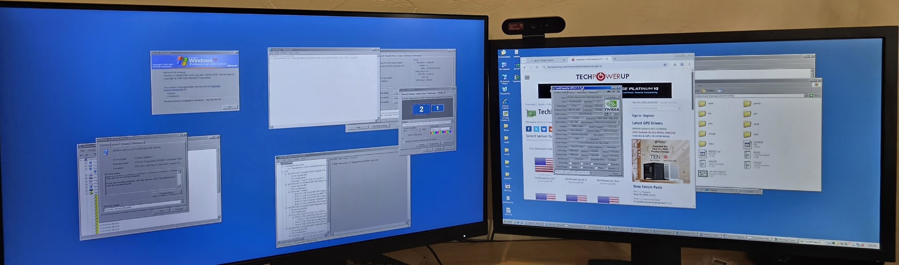

# NVIDIA Modern GPU Display Drivers for Windows XP x64 & Windows 98 SE (Version 2.0.0.1)

This repository provides open experimental display drivers bringing modern **NVIDIA Turing, Ampere, and Ada Lovelace GPUs** (GeForce RTX 3070, RTX 3060 Ti, and 200+ GPUs in the upstream database) to legacy Windows operating systems:
1. **Windows XP Professional x64 Edition** (XDDM 64-bit driver model)
2. **Windows 98 Second Edition (SE)** (Ring 0 VxD + 16-bit DIB Engine driver model)

### Version 2.0.0.1 Upstream Architecture
Version 2 integrates NVIDIA's official open-source kernel repository as a git submodule (`open-gpu-kernel-modules`, branch `535.113.01`):
- **Upstream OpenRM HAL Shim (`nvx_openrm_shim.c` / `nvx_openrm_shim.h`):** Provides a clean Hardware Abstraction Layer mapping VideoPort (NT/2000/XP 32-bit & 64-bit) and VMM (Win98 SE VxD) to OpenRM primitives (`GPU_REG_RD32`/`GPU_REG_WR32`, memory manipulation, microsecond stalls, and GSP doorbell notifications).
- **Official OpenRM Message Queue (`msgq.c`):** Directly compiles and links upstream `src/common/shared/msgq/msgq.c` into both 64-bit and 32-bit driver binaries for bidirectional host-GSP messaging queues.
- **Upstream VBIOS BIT & Falcon Parser:** Uses official OpenRM specifications (`NV_VBIOS_BIT_HEADER_ID`, `NV_VBIOS_BIT_TOKEN_*`, `FALCON_UCODE_TABLE_*`, RSA-3K BCRT30 structures) for authentic VBIOS probing and FWSEC/FRTS booter execution.
- **Upstream Open-GPU Headers & Shims (`nvx_nvidia_open_shim.h`):** Official NVIDIA SDK classes (`clc57e.h`, `cla06f.h`, `clc36f.h`), controls (`ctrl0073.h`, `ctrl2080.h`, `ctrl5070system.h`), and swref registers (`dev_gsp.h`, `dev_falcon_v4.h`, `dev_disp.h`).
- **Comprehensive Upstream GPU Table (`nvx_gpu_table.h`):** Auto-generated from official `g_nv_name_released.h` database covering 216 modern GPUs for authentic hardware detection and string reporting.
- **Cross-Target Architecture (XP x64, Win2K/XP 32-bit, Win98 SE):** Unifies core miniport logic across 64-bit and 32-bit platforms, establishing foundations for future Windows 2000 / XP 32-bit XDDM releases and OpenGL context scaffolding.
- **Dynamic EDID Detailed Timing & Resolution Generation:** Eliminates hardcoded monitor resolution tables on both Windows XP and Windows 98 SE, reading native monitor modes directly from EDID detailed timing descriptors.

Both operating systems are confirmed driving **dual physical monitors simultaneously** with an extended desktop:
- **Head 0 (Primary):** 1920×1080 @ 32bpp (DisplayPort / HDMI)
- **Head 1 (Secondary):** 2560×1440 @ 32bpp (DisplayPort)

**Bare-metal validation** was confirmed on an **AMD Ryzen AM5 platform with an EVGA GeForce RTX 3070 XC3 Ultra LHR**. Both drivers also operate inside QEMU/KVM virtual machines with GPU passthrough via Linux VFIO.



---

## Architectural Comparison

| Feature | Windows XP x64 | Windows 98 SE |
|---|---|---|
| **Driver Architecture** | Windows 2000/XP Display Driver Model (XDDM) | Hybrid Ring 0 VxD + 16-bit GDI Display Driver |
| **Kernel Component** | `nvxmp.sys` (64-bit video miniport driver) | `nvx.vxd` (32-bit LE Virtual Device Driver) |
| **Display Component** | `nvxdisp.dll` (64-bit GDI display driver) | `nvx.drv` (Head 0) & `nvx2.drv` (Head 1) (16-bit NE) |
| **2D Acceleration Engine** | Host software GDI + Ampere Copy Engine DMA fills | Microsoft DIB Engine (`DIBENG.DLL`) + RAM shadow buffer |
| **Hardware Bootstrap** | Authentic GSP-RM firmware booted via Falcon/SEC2 | Authentic GSP-RM firmware booted via Falcon/SEC2 |
| **Multi-Monitor Method** | Windows XP XDDM multi-head scanout surfaces | Windows 98 Desktop Virtualization (`attach_sec.exe`) |
| **Tested Resolutions** | 1920×1080 + 2560×1440 @ 32bpp True Color | 1920×1080 + 2560×1440 @ 32bpp True Color |

---

## Windows XP x64 Architecture

The Windows XP x64 driver consists of a 64-bit XDDM video miniport (`nvxmp.sys`) and a GDI display driver (`nvxdisp.dll`):
- **GSP-RM Firmware Bootstrap:** On system start, the miniport initializes the GA104 Falcon security coprocessor (SEC2), uploads the NVIDIA GSP-RM firmware payload from embedded binary storage, and establishes bidirectional command queues over DMA.
- **Dual Display Scanout:** The miniport configures two hardware display heads using GSP display RPC calls.
- **Copy Engine & 2D Fills:** A GSP-managed GPU Copy Engine (Ampere CE) performs solid fills and framebuffer updates for contiguous row segments. Unaccelerated complex rasterization falls back cleanly to CPU GDI routines.

---

## Windows 98 SE Architecture

Windows 98 SE uses a specialized dual-driver layout designed to run on top of modern GPU architectures:
- **VideoPort Shim Layer (`shim/videoprt_shim.c`):** An emulation layer implementing 22 Windows NT `VideoPort*` APIs on top of Windows 98 VMM (Virtual Machine Manager) ring 0 services. This allows the core 32-bit GA104 miniport engine (`src_driver/`) to run natively inside `nvx.vxd`.
- **DIB Engine Integration:** Both `nvx.drv` and `nvx2.drv` report `C1_DIBENGINE` (`0x0010`) and initialize standard `DIBENGINE` (`0x5250 'RP'`) PDEVICE descriptors, which is mandatory for Windows 98 to permit desktop extension across multiple monitors.
- **Shadow Buffer & Burst-Flush:** Head 0 maintains a linear shadow buffer in system RAM. Drawing calls are handled by `DIBENG.DLL` into RAM, and driver hooks in `BeginAccess` / `EndAccess` compute dirty bounding boxes and flush updated pixels to physical VRAM in high-speed burst copies.
- **Multi-Monitor Utility (`attach_sec.exe`):** A Win32 utility leveraging `ChangeDisplaySettingsExA` (`CDS_UPDATEREGISTRY`) to dynamically attach the secondary adapter (`\\.\Display2`) at `(1920, 0)` on demand.

For detailed design notes, see [src_win98/README.md](src_win98/README.md).

---

## Compatibility and System Requirements

- **Tested GPU:** EVGA GeForce RTX 3070 XC3 Ultra LHR (GA104, PCI Device ID `10de:2488`).
- **Compatible GPUs:** GA104-based cards (GeForce RTX 3070, RTX 3060 Ti, GA104 RTX 3060).
- **Tested Host Platform:** AMD Ryzen 7000 series on AM5 motherboard (bare metal) and QEMU/KVM with VFIO GPU passthrough.
- **Monitors Tested:** Dual DisplayPort setup running 1920×1080 (Primary) and 2560×1440 (Secondary) at 60 Hz.
- **Scope & Limitations:** 2D desktop acceleration, solid fills, and multi-monitor desktop extension are supported. 3D acceleration (OpenGL, DirectX 8/9/11/12), video decode acceleration (NVDEC), and audio over HDMI/DP are currently unaccelerated/unimplemented.

---

## Build Instructions

### Prerequisites
On a Debian or Ubuntu x86-64 host, install the cross-compilers and build dependencies:
```sh
sudo apt-get install build-essential gcc-mingw-w64-x86-64 gcc-mingw-w64-i686 binutils-mingw-w64
```
For the Windows 98 16-bit display driver, install [Open Watcom C/C++](http://openwatcom.org/) and JWasm.

### Building Windows XP x64 Driver
```sh
# Build 64-bit miniport with embedded GSP firmware
make -C src_driver full

# Build 64-bit GDI display driver
make -C src_disp

# Run host unit and regression checks
make -C src_driver check
make -C src_disp check
```
The output files are `src_driver/nvxmp.sys` and `src_disp/nvxdisp.dll`.

### Building Windows 98 SE Driver
```sh
# Set Open Watcom environment
source src_win98/owenv.sh

# Build 16-bit display drivers (nvx.drv & nvx2.drv)
cd src_win98/winvbe_drv && ./build.sh && cd ../..

# Build 32-bit Ring 0 VxD (nvx.vxd)
cd src_win98 && ./build_vxd.sh && cd ..

# Build secondary monitor attach utility
i686-w64-mingw32-gcc -O2 -s -o dist_win98/attach_sec.exe src_win98/attach_sec.c -luser32
```
The output files are generated in `dist_win98/`.

---

## Installation & Usage

### Installing on Windows XP x64
1. Download `nvx-driver-v1.1.0-xp-x64.zip` from [GitHub Releases](https://github.com/sanjayseshan/xddm_nvidia/releases) and extract its contents.
2. In Windows XP x64, open **Device Manager** -> **Display Adapters** -> **Standard VGA Graphics Adapter**.
3. Choose **Update Driver** -> **Have Disk...** and select `nvx.inf`.
4. Select the matching NVIDIA GeForce RTX model and reboot when prompted.
5. In **Display Properties** -> **Settings**, both displays can be arranged and enabled.

To update an existing installation directly from Linux:
```sh
XP_MOUNT=/mnt/xp ./test/update_xp_driver.sh
```

### Installing on Windows 98 SE
1. Download `nvx-driver-v1.1.0-win98se.zip` from [GitHub Releases](https://github.com/sanjayseshan/xddm_nvidia/releases) and extract its contents.
2. In Windows 98 SE, open **Device Manager** -> **Display Adapters** -> **Standard PCI Graphics Adapter (VGA)**.
3. Choose **Update Driver** -> **Specify location** and point to `nvx.inf`.
4. Select the NVIDIA GeForce RTX card and finish the wizard. Restart Windows 98.
5. Primary display boots to 1920×1080 @ 32bpp.
6. Run `ATTACH_SEC.EXE` (or use Display Properties) to activate the secondary monitor at 2560×1440 @ 32bpp.

To update an existing Windows 98 disk image offline:
```sh
./test/update_win98_driver.sh
```

---

## Hardware Testing & Virtualization

Automated test scripts in `test/` allow rapid iteration inside QEMU/KVM with the physical RTX 3070 bound to `vfio-pci`:
- `./test/run_all_tests.sh`: Runs all driver host unit tests and builds both 64-bit and 32-bit driver binaries.
- `./test/test_full_driver.sh`: Builds drivers, syncs to offline XP guest disk, and launches the VM.
- `./test/run_vfio_xp_autoretry.sh`: Auto-retrying Windows XP x64 VFIO bringup and monitoring.
- `./test/run_vfio_win98_autoretry.sh`: Auto-retrying Windows 98 SE VFIO bringup and monitoring.
- `./test/reset_test_gpu.sh`: Cycles GPU PCIe power state and restores host VFIO binding.

---

## Repository Structure

```
├── dist_full/           # Windows XP x64 release files (nvxmp.sys, nvxdisp.dll, nvx.inf, gsp_ga104.bin)
├── dist_win98/          # Windows 98 SE release files (nvx.drv, nvx2.drv, nvx.vxd, nvx.inf, attach_sec.exe)
├── src_driver/          # Unified GA104 miniport engine, GSP/RPC/MMU/Display code, and OpenRM HAL shim
├── src_disp/            # Windows XP x64 GDI display driver
├── src_win98/           # Windows 98 SE components:
│   ├── winvbe_drv/      # 16-bit DIB Engine display drivers (nvx.drv, nvx2.drv)
│   ├── shim/            # Ring 0 NT VideoPort to VMM translation layer
│   ├── attach_sec.c     # Win32 secondary monitor attachment utility
│   └── build_vxd.sh     # VxD compilation and packaging script
├── test/                # Test infrastructure, automated test runners, and QEMU/VFIO harness
├── open-gpu-kernel-modules/ # Official NVIDIA OpenRM upstream repository (submodule)
├── FIRMWARE_PROVENANCE.md # NVIDIA GSP/SEC2 firmware checksums and provenance
└── SUMMARY.txt          # Cumulative project hardware test log and history
```

---

## Credits & Acknowledgments

- **NVIDIA Corporation** for Ampere GA104 GPU hardware, GSP-RM and SEC2 microcode, and the [NVIDIA Open GPU Kernel Modules](https://github.com/NVIDIA/open-gpu-kernel-modules).
- **The Linux Nouveau DRM Team** for extensive documentation and public reference implementations of GSP initialization and sequencer logic.
- **Michal Necasek & Jmh (WINVBE Project)** for the open-source 16-bit DIB Engine Windows 98 display driver framework.
- **nullmoth ([nvidia-macos-driver](https://github.com/nullmoth/nvidia-macos-driver))** for community reverse-engineering notes on modern NVIDIA GPU architectures.
- **Sanjay Seshan** for physical GPU and multi-monitor validation, reverse engineering, hardware testing, and project creation.
- **GPT and Gemini** artificial intelligence models for paired programming, kernel shim engineering, and continuous debugging assistance.

---

## License & Firmware Notice

No project-wide open-source license has been specified. NVIDIA GSP-RM and SEC2 firmware components remain the intellectual property of NVIDIA Corporation and are subject to NVIDIA's licensing terms. Review [FIRMWARE_PROVENANCE.md](FIRMWARE_PROVENANCE.md) before redistributing.
